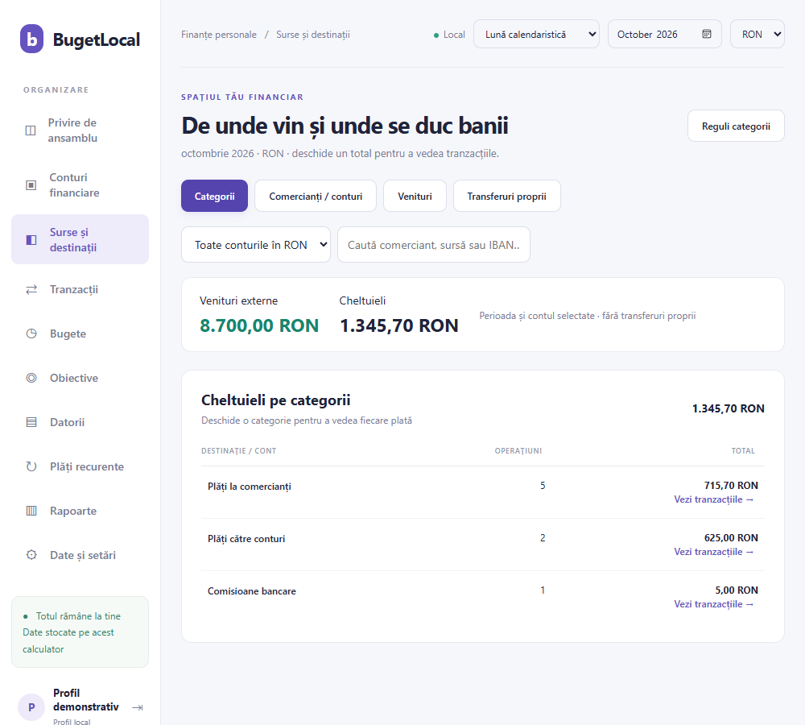

# Buget și finanțe — manual de utilizare

Versiunea aplicației: 1.6.3 · Ediția documentului: 9 noiembrie 2026

Buget și finanțe ține evidența banilor pe calculatorul tău. Importă extrase, urmărește veniturile și cheltuielile și compară situația pe lună calendaristică sau de la un salariu la următorul. Nu se conectează la conturile bancare și nu execută plăți.

## 1. Începe în ordinea aceasta

1. Deschide aplicația și creează un profil local.
2. Adaugă un cont financiar în moneda extrasului.
3. Completează soldul de dinaintea primei operațiuni pe care o vei introduce.
4. Configurează IBAN-urile proprii înainte de import.
5. Importă extrasul și verifică previzualizarea.
6. Alege luna sau perioada dintre două salarii.
7. Verifică veniturile pe surse și cheltuielile pe categorii/comercianți.
8. Creează un backup criptat și păstrează o copie pe alt suport.

## 2. Instalare și pornire

Pagina de descărcare pentru distribuția GitHub: https://raducostelcristian-design.github.io/bugetlocal-distributie/ . Linkul este utilizabil după activarea publicării; starea publicării este comunicată separat de autor.

Alege Descarcă pentru Windows, deschide BugetLocal-Setup-1.6.3-win-x64.exe și urmează pașii de instalare. La final apasă Deschide Buget și finanțe. La pornirile următoare folosește scurtătura Buget și finanțe de pe Desktop sau din meniul Start. Nu ai nevoie de CMD, Visual Studio, Node.js sau SDK .NET.

Pachetul beta este pentru Windows x64 și include runtime-ul .NET. Setup-ul verifică Microsoft Edge WebView2 și, dacă lipsește, rulează bootstrapperul oficial Microsoft; descărcarea componentei necesită internet. După pregătirea mediului, operațiunile financiare sunt locale.

Installerul nu este încă semnat digital de autor. Windows poate afișa o notificare privind un editor necunoscut; verifică sursa descărcării și hashul publicat. Nu dezactiva protecțiile Windows. Testele automate au trecut; testarea pe toate configurațiile Windows și într-un mediu curat fără WebView2 rămâne incompletă. Aceasta este o distribuție beta, nu o garanție de compatibilitate universală.

La actualizare, folosește același installer. Profilurile, parolele și tranzacțiile sunt păstrate în folderul local al aplicației. Fă periodic backup din Date și setări. Datele nu sunt incluse în installer sau încărcate pe site.

## 3. Profilul local și parola

La prima pornire, alege Creează un profil. Introdu un nume de utilizator și o parolă de minimum 6 caractere. Nu există utilizator ori parolă prestabilită. La următoarea pornire folosește datele acestui profil.

Soția sau un prieten poate crea un profil propriu. Conturile, tranzacțiile, perioadele, bugetele și regulile personale sunt separate în aplicație. Profilurile nu se sincronizează între laptopuri și nu există în prezent un buget comun de familie.

După 5 autentificări greșite, accesul la profil se suspendă 5 minute. După 15 minute fără operațiuni, aplicația blochează profilul și cere autentificarea. Parola poate fi schimbată din Date și setări, cu parola actuală. Nu există recuperare automată a parolei.

Separarea profilurilor nu criptează baza activă. Cine are acces direct la fișierele contului Windows poate accesa baza. Pentru persoane care nu trebuie să aibă acces reciproc la fișiere, folosește și conturi Windows separate.

## 4. Conturi financiare și sold inițial

În Conturi financiare, alege Cont nou. Completează numele, moneda, soldul inițial și, dacă dorești, titularul și IBAN-ul principal. Monede acceptate: RON, EUR, USD și GBP. Numerarul poate fi un cont separat.

Soldul inițial este suma existentă înaintea primei tranzacții pe care o înregistrezi. Dacă imporți un extras care începe la 1 octombrie, folosește soldul dinaintea operațiunilor din acea zi, nu soldul final al extrasului. Altfel, aceiași bani sunt numărați din nou.

Sold calculat = sold inițial + toate încasările − toate ieșirile din cont. Transferurile proprii modifică soldul chiar dacă nu sunt venituri sau cheltuieli.

Moneda unui cont cu tranzacții nu mai poate fi schimbată. Contul nu poate fi șters cât timp are operațiuni. Pentru altă monedă, creează alt cont. Aplicația nu face conversii valutare și nu însumează monede diferite.

## 5. Configurează transferurile între conturile tale

Deschide Conturi financiare → IBAN-uri proprii. Selectează contul financiar și completează listele, câte un IBAN pe rând. Aceste liste apar și înaintea importului.

| Setare | Bani primiți din acel IBAN | Bani trimiși spre acel IBAN |
| --- | --- | --- |
| IBAN principal al contului | Transfer intern | Transfer intern |
| IBAN-uri din același grup | Transfer intern | Transfer intern |
| Alte conturi proprii din care primesc bani | Transfer intern | Cheltuială |
| IBAN neconfigurat | Venit extern | Cheltuială |

Ultima listă permite, de exemplu, să excluzi din venituri bani veniți dintr-un cont propriu de la altă bancă, păstrând plățile către acel cont în cheltuielile urmărite aici. Dacă dorești excluderea în ambele sensuri, folosește lista aceluiași grup. Comportamentul depinde de listă, nu de numele băncii.

Aplicația nu decide că un cont este al tău după numele persoanei sau doar pentru că este la ING. Configurezi explicit IBAN-urile. Modificarea listelor recalculează importurile existente; alegerile făcute manual pentru o tranzacție se păstrează.

Un transfer importat înregistrează numai partea din extrasul citit. Nu inventează o a doua operațiune în alt cont. Pentru mutarea manuală între două conturi deja urmărite în aplicație, folosește Transfer: se creează ambele părți. Nu înregistra manual și apoi importa aceleași mișcări fără să verifici dublarea.

O încasare de la o persoană și plata ulterioară către altcineva rămân venit și cheltuială. Faptul că ai dat mai departe suma nu transformă automat încasarea într-un transfer propriu.

## 6. Importă un extras bancar

1. Deschide Tranzacții → Import extras sau Date și setări → Importă extras.
2. Selectează contul financiar în moneda extrasului.
3. Verifică listele IBAN-urilor proprii și salvează-le.
4. Alege fișierul CSV, XLS, XLSX sau PDF cu text.
5. Citește avertismentele și verifică datele, semnele sumelor și clasificarea transferurilor.
6. Selectează operațiunile pe care vrei să le imporți și confirmă.
7. Compară situația din aplicație cu extrasul: număr de operațiuni, intrări, ieșiri și sold.

Alegerea fișierului și previzualizarea nu salvează tranzacții. Listele IBAN-urilor sunt însă salvate la pasul anterior și pot modifica clasificările importurilor existente, chiar dacă anulezi alegerea fișierului.

| Format | Ce trebuie să știi |
| --- | --- |
| CSV | Antete Data, Descriere, Suma sau Debit/Credit; delimitator punct și virgulă, virgulă sau tab. În coloana Suma, cheltuielile sunt negative. |
| XLS / XLSX | Sunt citite toate foile. Previzualizarea indică foaia și rândul de proveniență. XLS binar și exporturile HTML cu extensie XLS sunt acceptate. |
| PDF | Textul trebuie să fie selectabil. Sunt recunoscute tabele Debit/Credit, inclusiv structuri ING verificate. Nu toate machetele bancare sunt acoperite. |

Limite: fișier de maximum 30 MB; PDF de maximum 300 pagini; Excel de maximum 50.000 rânduri în întregul registru și 100 coloane pe foaie. PDF-urile scanate nu au OCR inclus. Pentru un PDF nerecunoscut, încearcă exportul Excel sau CSV al băncii.

Dublurile sunt detectate după cont, dată, sumă și descriere, ținând cont și de aparițiile repetate identice. Reimportul aceluiași fișier nu ar trebui să dubleze operațiunile. Extrase diferite cu perioade suprapuse sau descrieri modificate trebuie verificate: nu există un identificator universal al tranzacției bancare.

## 7. Șterge un import întreg

Deschide Tranzacții → Istoric importuri. Identifică lotul după fișier și cont, verifică numărul de tranzacții și confirmă ștergerea lotului. Se șterg operațiunile acelui import; soldurile și totalurile se recalculează. Tranzacțiile manuale și celelalte loturi rămân. Fișierul bancar original nu este șters.

Pentru importurile vechi fără proveniență pe fișier apare un grup explicit de importuri anterioare pe cont. Ștergerea lui elimină toate importurile vechi ale acelui cont, nu un singur extras. Creează un backup înainte de ștergeri ample. Nu există buton de anulare a ștergerii.

## 8. Alege perioada: lună sau salariu

Selectorul din partea de sus oferă Lună calendaristică și De la salariu la salariu. Schimbarea lui nu copiază și nu mută tranzacții.

În modul salarial, introdu data salariului și data următorului salariu. Prima zi este inclusă, următoarea dată de salariu este exclusă. Exemplu fictiv: 25 octombrie → 25 noiembrie în formular înseamnă operațiunile din 25 octombrie până în 24 noiembrie inclusiv. Ziua de 25 noiembrie aparține perioadei următoare.

Folosește + pentru o perioadă nouă și creionul pentru modificarea celei selectate. Perioadele nu se pot suprapune. Nu este necesar ca salariul să vină în aceeași zi a fiecărei luni. Aplicația nu ghicește automat datele salariului.

Veniturile, cheltuielile, rapoartele și bugetele respectă selecția. Soldul de pe Privire de ansamblu este calculat la sfârșitul perioadei, cu banii reportați. În Conturi financiare, soldul include toate tranzacțiile, inclusiv cele viitoare deja introduse. De aceea cele două valori pot fi diferite.

## 9. Vezi de unde vin și unde se duc banii

În Surse și destinații ai patru vizualizări:

- Categorii: totaluri precum Utilități, Credite, Grădiniță sau Pensii private.
- Comercianți / conturi: fiecare comerciant separat și fiecare cont beneficiar separat.
- Venituri: fiecare sursă și cont de proveniență; transferurile proprii sunt excluse.
- Transferuri proprii: intrările și ieșirile proprii, separate de venituri și cheltuieli.

Folosește filtrele pentru cont, monedă, perioadă și căutare. Apasă Vezi tranzacțiile pentru operațiunile incluse într-un total. Apasă numele unei tranzacții pentru descrierea originală. Beneficiarii cu același nume, dar conturi diferite, rămân separați.

Imaginea folosește exclusiv date demonstrative; valorile ei nu reprezintă situația ta.

## 10. Reguli pentru categorii

În Surse și destinații → Reguli categorii poți crea, modifica și șterge reguli personale. Alege identificarea după Cont / IBAN beneficiar sau Nume comerciant / beneficiar și categoria dorită.

Contul trebuie să coincidă exact. La nume se acceptă numele integral sau începutul lui urmat de spațiu. O regulă pentru ENGIE recunoaște ENGIE RO BUCURESTI, dar nu ENGIEX. Spațiile, literele mari și diacriticele sunt normalizate pentru reguli pe nume. La conturi sunt acceptate și numere interne bancare.

Ordinea priorităților pentru cheltuieli importate este: categoria pusă manual pe tranzacție, regula personală pe cont, regula personală pe nume, recunoașterea generală. La mai multe prefixe personale se preferă cel mai lung. Transferurile proprii rămân transferuri, iar veniturile nu primesc categorii de cheltuieli.

Recunoașterea generală este disponibilă tuturor profilurilor: ENGIE, PPC, iHidro/Hidroelectrica, DIGI și E-BLOC sunt Utilități. NN este Pensii private sau Asigurări când descrierea precizează produsul; altfel apare Pensii / asigurări. IBAN-urile și regulile tale personale nu sunt copiate în profilul soției.

Regulile se aplică și tranzacțiilor deja importate, fără reimport. Ștergerea unei reguli păstrează tranzacțiile și recalculează categoria afișată. Pentru o operațiune izolată, modifică direct categoria tranzacției. Plățile nerecunoscute rămân vizibile în grupuri generale.

## 11. Tranzacții, bugete, obiective și datorii

În Tranzacții adaugi, modifici sau ștergi o operațiune. Alege Venit ori Cheltuială și introdu suma pozitivă, cu maximum două zecimale și fără separator de mii. Clasificarea Transfer între conturile mele exclude operațiunea din venituri/cheltuieli, dar păstrează efectul asupra soldului.

În Bugete stabilești o limită pe categorie, monedă și perioada aleasă. Bugetul salarial este separat de bugetul calendaristic. Schimbarea unei categorii sau reguli poate muta cheltuiala consumată între bugete.

În Obiective completezi ținta și suma economisită declarată. Actualizarea obiectivului nu mută efectiv bani între conturi și nu schimbă soldul lor.

În Datorii înregistrezi suma, suma achitată și scadența. Înregistrează plata creează o cheltuială în contul ales și reduce restul de achitat. O plată deja prezentă în extras nu trebuie introdusă încă o dată ca plată a datoriei. Nu există în această versiune o asociere automată între plata importată și datoria înregistrată.

Ștergerea unei tranzacții de plată recalculează suma achitată a datoriei. Pentru corectarea ei, șterge plata și înregistreaz-o din nou. Ștergerea datoriei păstrează istoricul cheltuielilor. Categoria Credite reprezintă o clasificare a plăților; nu creează automat o datorie sau un grafic de rambursare.

## 12. Plăți recurente și rapoarte

În Plăți recurente definești contul, suma, categoria, următoarea dată și frecvența săptămânală, lunară sau anuală. Procesarea la cerere înregistrează scadențele ajunse la termen; repetarea procesării nu le dublează. Nu se face nicio plată bancară și nu rulează un serviciu în fundal.

La sfârșit de lună, o dată inexistentă se ajustează la ultima zi disponibilă. Verifică această dată înaintea procesării următoare. Dacă aceeași plată apare în extras, evită dubla înregistrare manuală și prin import.

Rapoartele urmăresc perioada și moneda selectate. Graficul arată până la șase luni sau perioade salariale definite. Exportă CSV din Date și setări exportă toate tranzacțiile profilului, nu numai filtrul afișat. CSV-ul este lizibil și nu este criptat.

## 13. Backup, restaurare și mutare pe alt laptop

1. Deschide Date și setări → Creează backup.
2. Alege o parolă de minimum 12 caractere și confirm-o. Aceasta este parola fișierului de backup, separată de parola profilului.
3. Salvează fișierul .blbackup. Copiază-l și pe un stick sau alt suport de încredere.
4. Păstrează parola separat. Fără ea, backupul nu poate fi recuperat.

Backupul conține datele financiare ale profilului, inclusiv regulile și perioadele, dar nu parola de autentificare sau celelalte profiluri. Pentru mutare, instalează aplicația pe noul laptop, creează un profil, apoi folosește Restaurează backupul.

Restaurarea înlocuiește toate datele financiare din profilul curent, nu le combină. Celelalte profiluri rămân intacte. După verificare și confirmare se creează o copie criptată a stării anterioare, folosind parola backupului restaurat.

Copia automată .db creată înaintea unei migrări este necriptată și are alt rol decât backupul exportat .blbackup. Nu o trimite prietenilor. Nu distribui folderul data, fișiere SQLite, extrase bancare sau copii ale profilului.

## 14. Internet, actualizări și dezinstalare

Operațiunile financiare sunt locale. Codul aplicației permite o singură verificare online la pornire, dacă este configurată o adresă HTTPS pentru actualizări. În versiunea distribuită acum, adresa este necompletată, deci verificarea nu trimite cereri. Nu există descărcare sau instalare automată a actualizărilor în 1.6.3.

Componentele Windows și WebView2 au propriile mecanisme de actualizare, independente de BugetLocal. Verificarea instalației și datele financiare nu necesită un server personal.

Înainte de actualizare, creează un backup și închide aplicația. Urmează apoi instrucțiunile versiunii noi. Nu instala o versiune mai veche peste o bază cu structură nouă.

Dezinstalarea din Windows păstrează datele personale. Versiunea instalată le ține în %LOCALAPPDATA%\BugetLocal. Versiunea locală de dezvoltare folosește C:\Projects\BugetLocal\data prin scurtătura pregătită. Sunt foldere diferite; dacă pornești altă variantă, poate părea că datele au dispărut. Nu șterge nimic înainte să verifici calea și backupul.

## 15. Dacă o valoare nu pare corectă

| Situație | Ce verifici |
| --- | --- |
| Venituri prea mari | Perioada și moneda; IBAN-urile proprii; sursele din Venituri; încasările reale primite și date mai departe. |
| Sold prea mare sau prea mic | Soldul inițial, tranzacțiile dublate și diferența dintre soldul la sfârșitul perioadei și soldul pe toate datele. |
| Transfer tratat ca venit | IBAN-ul sursă trebuie să fie configurat; numele titularului nu este suficient. Verifică și clasificarea manuală. |
| Categorie neașteptată | Categoria manuală, regula pe cont, regula pe nume și descrierea originală, în această ordine. |
| XLS incomplet | Foaia și rândul în previzualizare, avertismentele și toate foile din fișier. |
| PDF fără operațiuni | Text selectabil, formatul tabelului și avertismentele; încearcă XLS/XLSX/CSV. |
| Import greșit | Backup, apoi ștergerea lotului din Istoric importuri și reimport corect. |
| Parolă respinsă | Profilul folosit, parola locală versus parola backupului și eventuala blocare de 5 minute. |
| Fereastra nu pornește | WebView2 Runtime, versiunea Windows și fișierul startup-error.txt din folderul de date, dacă există. |

Când ceri ajutor, comunică versiunea aplicației, pagina, perioada, mesajul de eroare și pașii care produc problema. Poți folosi exemple fictive; evită trimiterea bazei financiare sau a extraselor complete dacă nu sunt necesare.

## Confidențialitate și funcționare locală

Datele financiare, extrasele și rapoartele sunt prelucrate și salvate local, pe acest calculator. Aplicația nu le transmite și nu le publică pe internet. Folosirea zilnică nu necesită internet. Descărcarea aplicației, instalarea WebView2 când lipsește și verificarea opțională de actualizări la pornire pot necesita internet, fără trimiterea datelor financiare.

Tu decizi cui trimiți exporturile și backupurile. Autorul nu răspunde pentru publicarea sau distribuirea datelor de către utilizator. Protejează contul Windows și fișierele locale; baza activă SQLite nu este criptată.

Powered by Cristian Radu. Ilustrație de Edward.

## Scurtătura Desktop după actualizare

Din versiunea 1.6.3, installerul creează automat scurtătura Buget și finanțe cu pictograma nouă și înlocuiește vechea scurtătură BugetLocal. Folosește aceeași bază locală ca meniul Start. Conturile și datele introduse sunt păstrate la actualizare. Desenul lui Edward rămâne în ecranul de autentificare.

## Setarea soldului inițial

În Conturi financiare, fiecare cont are butonul Setează soldul inițial. Introdu suma existentă înaintea primei tranzacții urmărite. Formularul arată prima dată înregistrată și previzualizează soldul calculat după salvare. Sunt acceptate două zecimale și solduri negative.

Soldul inițial nu este un venit, nu creează tranzacții și nu modifică rapoartele de venituri și cheltuieli. Nu introduce soldul curent al băncii dacă ai înregistrat deja operațiunile care au dus la acel sold.
